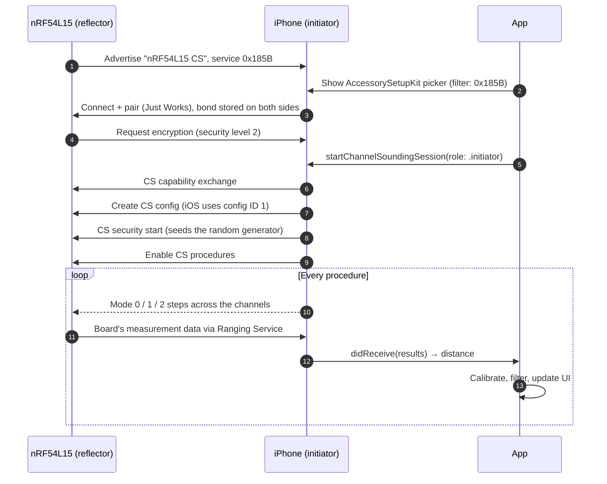

# Channel Sounding: iPhone ↔ nRF54L15 distance measurement

Measure the distance between an iPhone and a Nordic **nRF54L15 DK** using
**Bluetooth LE Channel Sounding** (Bluetooth 6.0).

- **The device** (`firmware/`): firmware for the nRF54L15 DK. The board acts as
  the Channel Sounding **reflector**: it advertises, pairs, and answers the
  phone's measurements.
- **The app** (`ios/`): a SwiftUI app. The iPhone acts as the Channel Sounding
  **initiator**: it pairs with the board, runs the measurements, and shows a
  filtered live distance with a chart.

```
┌──────────────────────┐      Bluetooth LE (encrypted link)     ┌──────────────────────┐
│  iPhone (iOS 27.2+)  │ ◄────────────────────────────────────► │    nRF54L15 DK       │
│  Initiator           │   CS procedures: tones + timing on up  │    Reflector         │
│  Core Bluetooth CS   │   to 72 channels                       │    "nRF54L15 CS"     │
│  + distance filter   │   Ranging Service (0x185B): board's    │    Zephyr / NCS 3.4  │
│                      │   measurements sent to the phone       │                      │
└──────────────────────┘                                        └──────────────────────┘
```

## Repository layout

| Path | What it is |
|------|------------|
| `firmware/` | Zephyr app for the nRF54L15 DK, based on Nordic's `ras_reflector` sample from nRF Connect SDK v3.4.1 |
| `firmware/prj.conf` | Bluetooth, bonding, and Channel Sounding settings |
| `firmware/src/main.c` | Advertising, connection handling, CS logging, bond-clear button |
| `ios/channel-sounding.xcodeproj` | Xcode project |
| `ios/MyApp/ChannelSoundingManager.swift` | Pairing (AccessorySetupKit), connection (Core Bluetooth), Channel Sounding session, RSSI, calibration |
| `ios/MyApp/RangeFilter.swift` | Turns noisy readings into a stable distance |
| `ios/MyApp/ContentView.swift` | The UI: status, distance card, chart, controls |

---

## How Bluetooth Channel Sounding works

Channel Sounding (CS) is part of Bluetooth Core 6.0. It lets two Bluetooth LE
devices measure the distance between them much more precisely than signal
strength (RSSI) can. RSSI changes a lot with orientation, hands, and walls, so it
can only give a rough idea of distance.

### Two roles

- The **initiator** (here, the iPhone) sets up and starts the measurements, and
  computes the distance.
- The **reflector** (here, the nRF54L15) responds to each measurement and sends
  its own measurement data back so the initiator can combine both sides.

### Phase-based ranging (PBR): the precise part

Each side sends a plain radio tone and measures the phase of the tone it
receives back. The phase of a radio wave depends on how far it has travelled and
on its frequency. If you repeat the exchange on many frequencies, the phase
changes in a straight line as the frequency increases, and **the slope of that
line is proportional to the distance**:

```
d = c · Δφ / (4π · Δf)
```

where `c` is the speed of light, `Δf` is the frequency step, and `Δφ` is the
change in round-trip phase over that step. CS uses up to **72 channels, 1 MHz
apart** (2404–2478 MHz). With 1 MHz steps, the result is unambiguous up to
`c / (2 · 1 MHz) ≈ 150 m`.

Each radio's local oscillator adds an unknown phase offset. Because both sides
measure and their results are combined, those unknown offsets cancel out. That's
why the reflector has to send its measurements to the initiator.

### Round-trip time (RTT): the coarse part

The devices also time a packet exchange. Radio travels about 30 cm per
nanosecond, so RTT gives a coarser distance (around a metre). It still helps:
it's harder to fool and it can catch phase results that are wildly wrong.

### Procedures, subevents, and steps

Measurements are organised in **procedures** that repeat at an interval chosen
by the initiator. Each procedure is split into **subevents**, and each subevent
into **steps**. Each step uses one channel and one **step mode**:

| Mode | What happens | Used for |
|------|--------------|----------|
| 0 | Packet exchange to measure the frequency offset between the two radios | Calibration, done at the start of each subevent |
| 1 | Timed packet exchange | Round-trip time (RTT) |
| 2 | Tone exchange on one channel | Phase-based ranging (PBR) |
| 3 | Modes 1 and 2 combined in one step | RTT and PBR together (turned off in this firmware) |

### Security

Before CS runs, the link must be **encrypted**. The two controllers then seed a
shared random number generator from the encrypted link. It decides the channel
order and randomises parts of the packets. An attacker can't predict or replay
these, which protects against relay attacks that try to make a device look
closer than it is.

### Ranging Service (RAS)

The initiator needs the reflector's measurements. The **Ranging Service**
(16-bit UUID **0x185B**) is the standard way to send them: the reflector stores
its measurement data for each procedure in RAS, and the initiator reads it over
GATT. On iOS this happens inside Core Bluetooth; the app only receives the final
distance.

### Why readings are still noisy

Radio waves bounce off walls, floors, and people (**multipath**). The receiver
then sees several copies of the signal that took different paths, which can
shift a single reading by a metre or more. A hand or body between the devices
also blocks the direct path. The app's filter is there to reduce these effects.

---

## End-to-end flow



The board never starts measurements on its own: the iPhone picks the CS
configuration, timing, and channels, and the board only responds.

---

## The device: nRF54L15 DK firmware

### Hardware

- Nordic **nRF54L15 DK** (PCA10156), board target `nrf54l15dk/nrf54l15/cpuapp`
- USB-C cable that carries data, plugged into the DK's J-Link USB port

### What the firmware does

- **Advertises** connectable, every 100–150 ms, as **`nRF54L15 CS`** with the
  Ranging Service UUID **0x185B**. The iOS picker filters on this UUID.
- **Pairs** with "Just Works" (no passkey) and saves bonds to flash, so the
  phone can reconnect after a reset.
- **Asks for encryption** right after a phone connects, so the link is secure
  before Channel Sounding starts.
- **Acts as the CS reflector** with the **Ranging Service server** (RAS
  responder), so the iPhone can read the board's measurement data.
- **Leaves all CS decisions to the iPhone.** The board turns on the reflector
  role and then waits. The iPhone creates the config and starts the procedures.
- **Reboots after each disconnect**, so every session starts clean.
- **Logs** each step (connection, security level, CS capability exchange,
  config, procedures) to the serial console.

### Key settings (`firmware/prj.conf`)

| Setting | Value | Why |
|---------|-------|-----|
| `CONFIG_BT_DEVICE_NAME` | `"nRF54L15 CS"` | Name shown in the picker |
| `CONFIG_BT_BONDABLE`, `CONFIG_BT_SETTINGS` | `y` | Bonding saved to flash; needed by AccessorySetupKit's LE pairing |
| `CONFIG_BT_SMP_ALLOW_UNAUTH_OVERWRITE` | `y` | A phone that "forgot" the board can pair again without erasing the board |
| `CONFIG_BT_MAX_PAIRED` / `CONFIG_BT_KEYS_OVERWRITE_OLDEST` | `4` / `y` | Up to 4 phones; the oldest bond is replaced when full |
| `CONFIG_BT_CTLR_SDC_CS_ROLE_REFLECTOR_ONLY` | `y` | The board is always the reflector |
| `CONFIG_BT_CTLR_SDC_CS_STEP_MODE3`, `CONFIG_BT_RAS_MODE_3_SUPPORTED` | `n` | Mode 3 off to save RAM; modes 1 and 2 cover RTT and PBR |
| `CONFIG_BT_RAS_MAX_ANTENNA_PATHS`, `CONFIG_BT_CTLR_SDC_CS_MAX_ANTENNA_PATHS` | `2` | Lets a phone with two antennas use both |
| `CONFIG_BT_CTLR_TX_PWR_PLUS_8` | `y` | +8 dBm, the nRF54L15's maximum, for range and signal quality |
| `CONFIG_BT_CTLR_EXTENDED_FEAT_SET` | `y` | Bluetooth 6.0 extended feature exchange |
| `CONFIG_BT_L2CAP_TX_MTU` | `498` | The Ranging Profile recommends an MTU of at least 247 bytes |

### Buttons and LEDs

| Control | Behaviour |
|---------|-----------|
| **LED0** | On while a phone is connected |
| **BUTTON 0** | Hold it while pressing RESET to **erase all stored bonds** |
| **RESET** | Restarts the board |

The nRF54L15 DK numbers its buttons and LEDs from 0. In the code, `DK_BTN1` and
`DK_LED1` refer to BUTTON 0 and LED0.

### Build and flash

You need:

- **nRF Connect SDK v3.4.1** and its toolchain, installed with
  `nrfutil sdk-manager` (for example in `~/ncs/v3.4.1`).
- **SEGGER J-Link** software, and on Linux the J-Link udev rules (installed by
  the J-Link package).
- On Linux, membership of the `dialout` group to open the serial console.

Build and flash:

```sh
ZEPHYR_BASE=~/ncs/v3.4.1/zephyr nrfutil sdk-manager toolchain launch --ncs-version v3.4.1 -- \
  west build -b nrf54l15dk/nrf54l15/cpuapp -s <repo>/firmware -d <repo>/firmware/build

ZEPHYR_BASE=~/ncs/v3.4.1/zephyr nrfutil sdk-manager toolchain launch --ncs-version v3.4.1 -- \
  west flash -d <repo>/firmware/build
```

> **The path must not contain spaces.** Zephyr's build fails with
> `File not found: .../<first word of the path>` if it does. Clone the repo into
> a path without spaces, or point a symlink without spaces at it and use the
> symlink path in `-s` and `-d`.

After flashing, unplug and replug the DK once before testing with the iPhone.
A full power cycle has been more reliable for Channel Sounding than the reset at
the end of flashing.

### Serial console

115200 baud, 8N1. The DK exposes two serial ports; on our board the console is
the **second** one (`/dev/ttyACM1` on Linux). If you see nothing, try the other
port.

```sh
screen /dev/ttyACM1 115200      # exit with Ctrl-A, then K
```

A successful ranging session looks like this:

```
I: Connected to <phone address> (err 0x00)
I: Security level 2
I: CS capability exchange completed.
I: CS config creation complete.
 - id: 1
 - role: Reflector
 ...
I: CS security enabled.
I: CS procedures enabled:
 ...
```

---

## The app: iOS initiator

### Requirements

- An iPhone that supports Bluetooth Channel Sounding, running **iOS 27.2 or
  later** (developed with an iPhone 17). The app checks
  `CBCentralManager.supports(.channelSounding)` and shows an error otherwise.
- Xcode with the iOS 27 SDK. Open `ios/channel-sounding.xcodeproj`, set your
  signing team, and run on the device.

### How it works

1. **Pairing with AccessorySetupKit.** `Info.plist` declares
   `NSAccessorySetupKitSupports = Bluetooth` and
   `NSAccessorySetupBluetoothServices = 185B`. **Add Accessory** shows the
   system picker filtered on 0x185B with the `.bluetoothPairingLE` option, so iOS
   pairs and bonds with the board during setup.
2. **Connecting with Core Bluetooth.** The app creates its `CBCentralManager`
   only after pairing, because creating it earlier triggers the Bluetooth
   permission prompt and blocks the picker. It then connects using the
   accessory's Bluetooth identifier. If Core Bluetooth doesn't know the device
   yet, the app scans for 0x185B to find it. A paired board is reconnected
   automatically when the app starts.
3. **Ranging.** **Start Ranging** calls `startChannelSoundingSession` with
   `CBChannelSoundingSessionConfiguration(role: .initiator)`. iOS handles the CS
   setup and the Ranging Service reads, and reports each distance through
   `peripheral(_:didReceive:error:)`. Negative distances mean "no valid
   measurement" and are skipped.
4. **RSSI.** While ranging, the app reads RSSI every 0.5 s and smooths it
   (exponential, weight 0.3). The filter uses it to tell real movement from
   multipath jumps.
5. **Errors.** Core Bluetooth errors are shown with their code, plus a hint for
   the known Channel Sounding failures (see Troubleshooting).

### Distance processing (`RangeFilter`)

Each reading goes through:

1. **Calibration offset**: a fixed offset (see below) is subtracted.
2. **Median of the last 7 readings**: removes single-reading spikes.
3. **Jump gate**: if the median jumps more than **1 m** from the current estimate
   while RSSI stays flat (less than **3 dB** change over the last second), the
   jump is probably multipath, so it's held back. It's accepted once **3
   readings in a row** agree, or immediately if RSSI also changed. Held-back
   readings are counted.
4. **1D Kalman filter**: smooths the remaining jitter while still following real
   movement.

### Calibration

Every phone/board pair has a small fixed error. To remove it, place the board
exactly **1 m** from the phone with a clear line of sight. Wait for the reading
to settle, then choose **⋯ › Calibrate at 1 m**. The offset is saved on the
phone and applied to every reading. **Reset Calibration** sets it back to 0.

### The screen

- **Status**: Not connected / Connecting / Connected / Ranging.
- **Distance card**: the filtered distance in large type, then the raw reading,
  the spread (standard deviation of the last 20 raw readings, shown as ±cm), the
  RSSI, and the calibration offset.
- **Chart**: the last 200 readings, raw (thin) and filtered (thick).
- **Controls**: Add Accessory or Connect, Start/Stop Ranging, Disconnect.
- **⋯ menu**: Calibrate at 1 m, Reset Calibration, Forget Accessory.

### Using it

1. Flash the board and power-cycle it.
2. Open the app and tap **Add Accessory**. Pick **nRF54L15 Reflector** and allow
   pairing.
3. Once it shows **Connected**, tap **Start Ranging**.
4. Optionally calibrate at 1 m.

---

## Troubleshooting

| Symptom | Likely cause | Fix |
|---------|--------------|-----|
| Board doesn't appear in the picker | Board not powered or not advertising | Check the DK's POWER switch and the serial log. Check with any BLE scanner for `nRF54L15 CS` / 0x185B |
| Pairing fails, or the connection drops right after connecting | The iPhone and the board disagree about the bond. This happens after erasing or reflashing with a changed bond format, or after clearing bonds on the board | On the iPhone, **⋯ › Forget Accessory** (or Settings › Bluetooth › Forget This Device), then add it again. To clear the board's side, hold BUTTON 0 while pressing RESET |
| Serial log shows `Pairing/encryption failed (security err N, level L)` | `2` = key missing on one side; `4` = iOS wanted a passkey; `6` = pairing not allowed | Re-pair as above |
| `ChannelSoundingConfigurationFailed` (CBError 19) | Known iOS 27 behaviour on the first attempt right after a fresh pairing | Leave the app open, power-cycle the DK, reconnect, and start ranging again |
| "The board connected but didn't accept Channel Sounding" | The board isn't running CS reflector firmware with RAS | Flash `firmware/` |
| Distance is consistently off by the same amount | Fixed per-device offset | Calibrate at 1 m |
| Distance jumps around | Multipath, or a hand or body between the devices | Keep a clear line of sight. The filter holds back most jumps |
| DK not detected on USB | POWER switch off, charge-only cable, or a hub | Switch it on, use a data cable, plug it straight into the computer |
| Build fails: `File not found: .../<part of path>` | Space in the path | Build from a path without spaces |

Disconnect reasons in the serial log: `0x13` = the iPhone closed the connection
normally; `0x08` = the link timed out (range or interference); `0x3D` = the two
sides' keys don't match (re-pair).

---

## References

- [Bluetooth Core Specification 6.0](https://www.bluetooth.com/specifications/specs/)
  (Vol 6, Part H: Channel Sounding), and the Ranging Service and Ranging Profile
  specifications
- [nRF Connect SDK documentation](https://docs.nordicsemi.com/): Channel
  Sounding samples and the nRF54L15 DK user guide
- [Apple Core Bluetooth documentation](https://developer.apple.com/documentation/corebluetooth)
  and [AccessorySetupKit](https://developer.apple.com/documentation/accessorysetupkit)

## License

The firmware is based on Nordic Semiconductor's `ras_reflector` sample and keeps
its `LicenseRef-Nordic-5-Clause` license headers.
